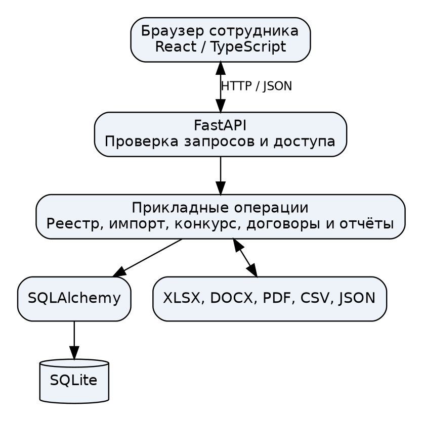
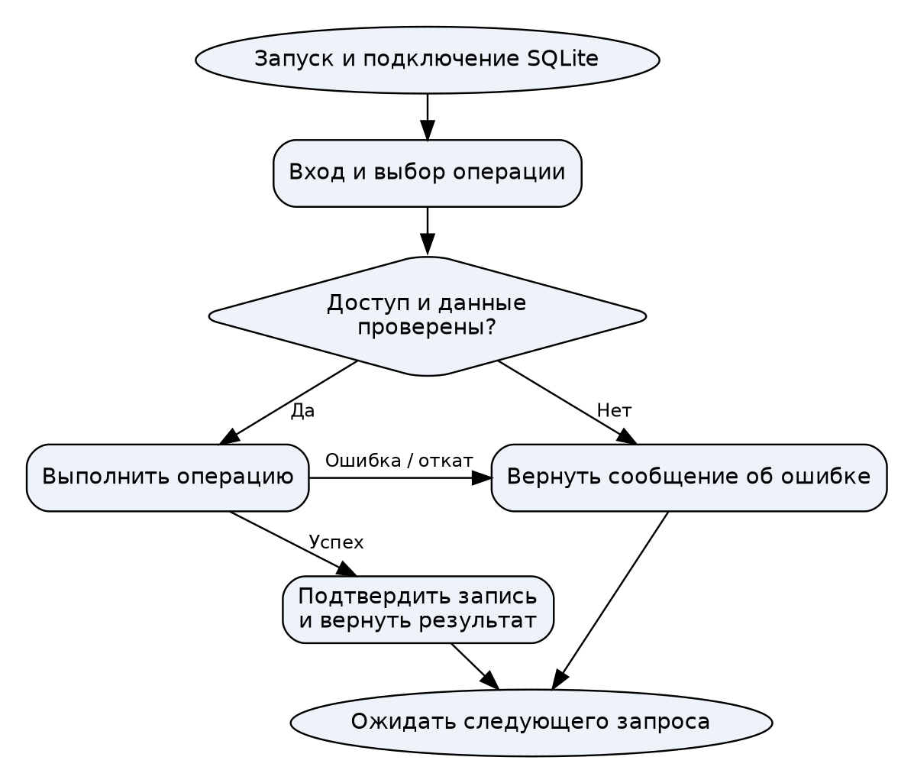
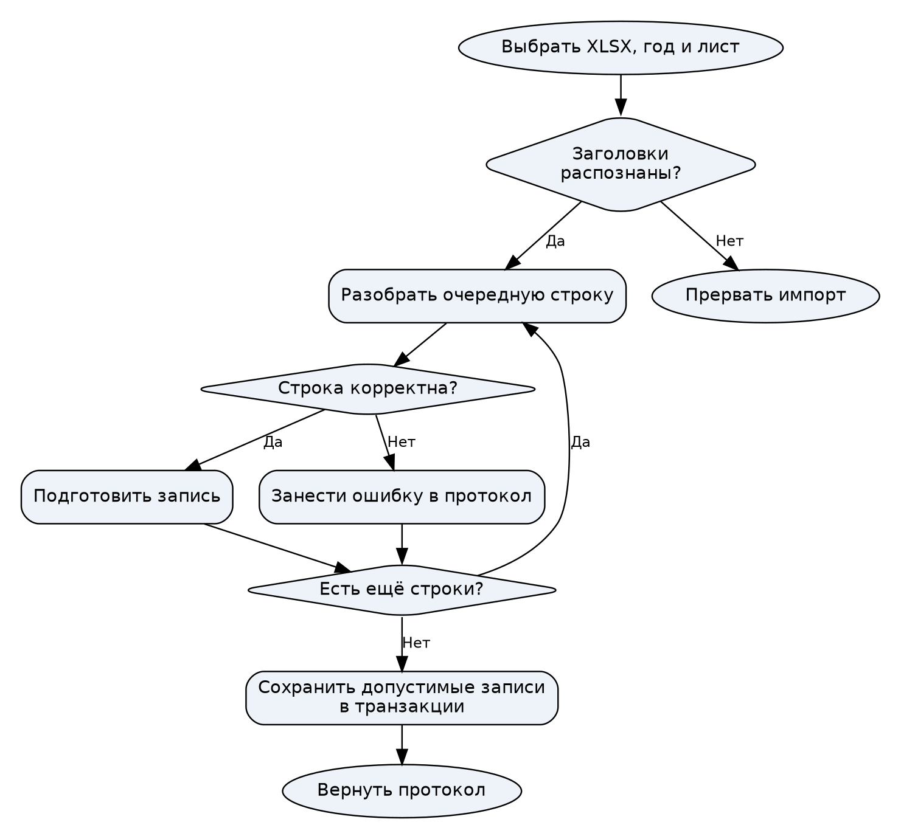
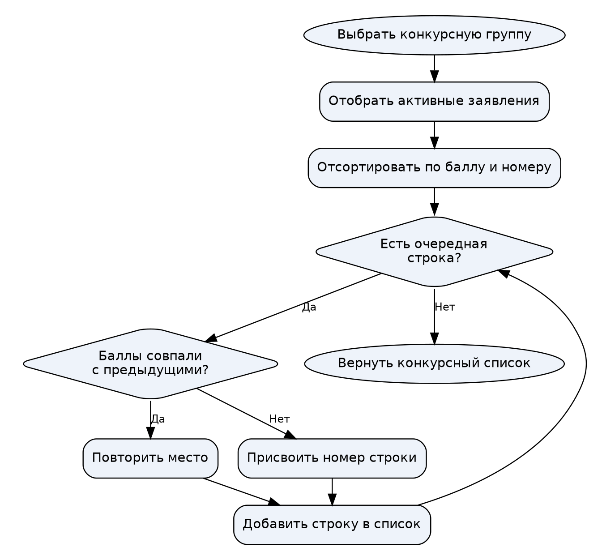
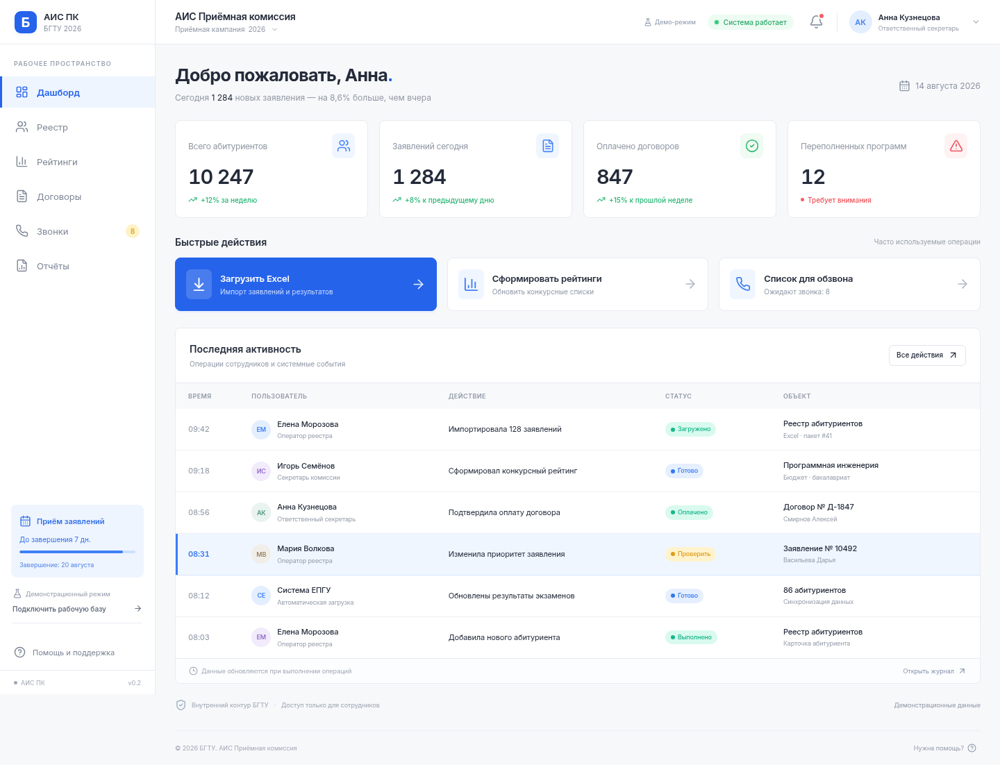

# СОДЕРЖАНИЕ

ВВЕДЕНИЕ _________________________________________________________________  
1. Анализ области использования разрабатываемого программного продукта  
2. Моделирование проектируемой системы  
3. Разработка технического задания  
4. Разработка архитектуры программной системы  
5. Разработка структуры данных  
6. Разработка схемы алгоритмов основной программы и подпрограмм  
7. Конструирование пользовательского интерфейса  
8. Тестирование программы  
ЗАКЛЮЧЕНИЕ  
СПИСОК ИСПОЛЬЗУЕМЫХ ИСТОЧНИКОВ  
ПРИЛОЖЕНИЕ A Руководство системного программиста  
ПРИЛОЖЕНИЕ Б Руководство пользователя  
ПРИЛОЖЕНИЕ В Фрагменты кода программы  

# ВВЕДЕНИЕ

Во время приёмной кампании сотрудники Политехнического колледжа ФГБОУ ВО «Брянский государственный технический университет» регистрируют заявления, проверяют документы, ведут конкурсные списки и учитывают договоры на платное обучение. При ведении этих сведений в нескольких таблицах повторяется ввод, а изменения приходится сверять вручную.

Цель работы — разработать внутреннюю автоматизированную информационную систему (АИС) приёмной комиссии ПК БГТУ. Задачи работы: изучить порядок обработки заявлений, построить модель предметной области, подготовить техническое задание, спроектировать архитектуру и структуру данных, описать алгоритмы, разработать рабочие формы сотрудников и проверить основные операции на синтетических данных.

Объект исследования — обработка заявлений о приёме на программы среднего профессионального образования (СПО). Предмет исследования — методы централизованного учёта заявлений, конкурсных групп, договоров и оплаты. В границы работы входит служебный интерфейс сотрудников комиссии. Поступающий передаёт документы и получает информацию через установленные колледжем каналы.

# 1. Анализ области использования разрабатываемого программного продукта

## 1.1 Описание предметной области

Разрабатываемый программный продукт представляет собой автоматизированную информационную систему приёмной комиссии Политехнического колледжа ФГБОУ ВО «Брянский государственный технический университет» (БГТУ), предназначенную для сотрудников комиссии и руководства колледжа.

Основная деятельность пользователей системы:

- приём и проверка заявлений и документов абитуриентов;

- ведение реестра поступающих и подготовка конкурсных списков;

- оформление договоров на платное обучение и учёт оплаты;

- информирование поступающих и подготовка отчётности по приёму.

Предметная область включает процессы сопровождения приёма на программы среднего профессионального образования: от регистрации заявления до учёта зачисления. Конкурс проводится по критериям действующих правил приёма колледжа с учётом документов об образовании и вступительных испытаний при их наличии.

Основные бизнес-процессы, подлежащие автоматизации:

- загрузка заявлений из Excel-файлов с проверкой данных;

- хранение сведений об абитуриентах, документах и специальностях;

- формирование конкурсных списков по установленным критериям;

- подготовка договоров по шаблону и контроль этапов оформления;

- регистрация оплаты и результатов обзвона поступающих;

- подготовка отчётов и выгрузок для передачи в систему 1С;

- ведение истории изменений и резервное копирование данных.

Проблемы текущей организации работы:

- ручной перенос сведений между таблицами требует значительных затрат времени;

- раздельное хранение заявлений, договоров и оплат приводит к расхождениям;

- ручная подготовка конкурсных списков увеличивает риск ошибок;

- бумажное согласование договоров затрудняет контроль этапов оформления;

- отсутствие единого источника информации усложняет отчётность.

Обоснование необходимости автоматизации.

Разработка АИС позволит объединить заявления, конкурсные списки, договоры и сведения об оплате в общей базе данных. Внутренний интерфейс обеспечит сотрудникам поиск и обработку информации. Сотрудники информируют поступающих через установленные колледжем каналы. Автоматизация загрузки данных и подготовки документов сократит повторный ввод и повысит согласованность учёта. История изменений и резервное копирование улучшат контроль операций и сохранность информации. Доступ к персональным данным должен разграничиваться по обязанностям пользователей.

## 1.2 Бизнес-требования

### 1.2.1 Описание бизнес-проблемы

При проведении приёмной кампании необходимо согласовывать сведения о заявлениях, конкурсных списках, договорах и оплатах. В рассматриваемом процессе учёт ведётся в отдельных электронных таблицах и на бумажных носителях, что требует ручного переноса и постоянной сверки данных.

Это приводит к следующим проблемам:

- значительные трудозатраты на ввод и проверку сведений;

- дублирование записей и расхождения между реестрами;

- задержки при обновлении конкурсных списков и подготовке отчётов;

- сложность контроля договоров и информирования поступающих.

В результате возрастает нагрузка на сотрудников и затрудняется оперативный контроль хода приёмной кампании.

Разработка АИС с общей базой данных позволит централизовать учёт и автоматизировать повторяющиеся операции. Числовые показатели далее являются целями разработки; их достижение предстоит проверить при опытной эксплуатации.

### 1.2.2 Цели бизнеса

Таблица 1.2.1 – Цели бизнеса

| Цель | Описание | Критерии успеха |
| --- | --- | --- |
| Сокращение времени обработки данных | Автоматизация загрузки и обновления сведений | Время обработки данных сокращено на 70% |
| Снижение ошибок учёта | Проверка данных и контроль повторных записей | Количество ошибок учёта снижено на 90% |
| Ускорение отчётности | Формирование конкурсных списков и сводных отчётов | Время подготовки отчётов сокращено на 80% |
| Централизация учёта | Хранение заявлений, договоров и оплат в общей базе | Связанные сведения доступны сотруднику в одном интерфейсе |

### 1.2.3 Заинтересованные стороны (Stakeholders)

Таблица 1.2.2 - Заинтересованные стороны (Stakeholders)

| Stakeholders | Роль | Интересы | Влияние |
| --- | --- | --- | --- |
| Руководство БГТУ и колледжа | Заказчик | Выполнение плана набора и контроль хода приёма | Высокое |
| Сотрудники приёмной комиссии | Основные пользователи | Быстрая обработка заявлений и снижение ручной работы | Высокое |
| Бухгалтерия и участники согласования | Участники процесса | Корректность договоров, учёт оплаты и контроль оформления | Среднее |
| Абитуриенты и их родители | Внешние участники | Актуальная конкурсная информация и понятный порядок поступления | Среднее |

### 1.2.4 Бизнес-ценность продукта

Количественная ценность:

- целевое сокращение времени обработки данных на 70% за счёт автоматизации загрузки и уменьшения повторного ввода;

- целевое снижение числа ошибок учёта на 90% благодаря проверкам и согласованному хранению сведений;

- планируемое сокращение времени подготовки отчётов на 80% относительно ручного выполнения сопоставимых операций.

Качественная ценность:

- повышение оперативности контроля приёмной кампании;

- обеспечение согласованности заявлений, договоров и сведений об оплате;


- снижение рутинной нагрузки на сотрудников приёмной комиссии;

- повышение прослеживаемости изменений и сохранности данных.

# 2. Моделирование проектируемой системы

## 2.1. Исходный и проектируемый процессы

В исходном процессе сотрудник переносит сведения заявления в рабочий реестр, затем сверяет данные со смежными таблицами. При изменении приоритета, статуса или условий обучения требуется повторно сформировать конкурсный список. Оплата сверяется по номеру договора, а результаты звонков фиксируются отдельно. При несовпадении номера договора или заявления сотрудник обращается к первичному документу.

Приёмная комиссия получает исходные данные от поступающего или из выгрузки ЕПГУ. Бухгалтерия предоставляет сведения об оплате. Руководитель комиссии получает сводки через сотрудников, ответственных за подготовку отчётности.

В проектируемом процессе комиссия регистрирует поступающего и заявление в одной системе. Оператор вводит сведения вручную либо загружает выгрузку ЕПГУ. АИС проверяет формат полей и связывает записи по внутреннему номеру поступающего. Работник задаёт параметры конкурсной группы и план мест. Договор связывается с заявлением, а поступившая оплата — с номером договора. Из общей базы формируются служебные списки и отчёты. Сотрудник фиксирует приказ о зачислении после проверки документов и условий приёма.

## 2.2. Информационно-логическая модель

Данные представлены восемью сущностями. На рисунке 2.1 показаны связи между сущностями. Сплошные стрелки соответствуют связям по ключам, пунктирные — сопоставлению конкурсной группы и логина исполнителя. Обозначение 0..* означает ноль или несколько записей, 0..1 — ноль или одну запись.


Рисунок 2.1 — Информационно-логическая модель АИС

## 2.3. Элементы, связи и ограничения модели

| Элемент | Данные и назначение |
|---|---|
| Поступающий | Идентифицируется текстовым номером. Карточка объединяет Ф. И. О. и дополнительные сведения. |
| Заявление | Содержит год, кампанию, специальность, форму обучения, категорию, приоритет, результат конкурса и статус. |
| План мест | Хранит число мест для комбинации года, кампании, специальности, формы и категории. |
| Договор | Содержит уникальный номер, состояние оформления, местонахождение и отметку об оплате. |
| Событие по договору | Фиксирует дату, исполнителя и содержание изменения договора. |
| Звонок | Хранит по заявлению результат контакта, комментарий, исполнителя и время. |
| Пользователь | Служебная учётная запись с логином, хешем пароля и признаком активности. |
| Действие | Запись журнала об операции сотрудника, объекте, времени и результате. |

У одного поступающего может быть несколько заявлений, но каждое заявление относится к одному поступающему. Повтор комбинации «поступающий, год, кампания, специальность, форма обучения, категория» запрещён. Это даёт возможность вести разные конкурсные группы для одной карточки и повторно импортировать выгрузку без создания копий заявлений.

Заявления сопоставляются с планом мест по пяти параметрам группы. Один план соответствует множеству заявлений. При отсутствии плана сотрудник должен уточнить число мест, прежде чем использовать показатели заполнения. План мест и заявление сопоставляются по значениям полей, без внешнего ключа.

На одно заявление приходится до одного договора. У договора может быть несколько событий, а у заявления — несколько записей об обзвоне. Для истории и журнала используется сохранённый текстовый логин исполнителя, поэтому запись о действии можно прочитать после деактивации учётной записи. Эти поля не являются внешними ключами.

## 2.4. Входные и выходные потоки данных

| Поток | Вход | Преобразование и результат |
|---|---|---|
| Регистрация | Карточка и реквизиты заявления | Проверка и сохранение связанных данных в одной транзакции. |
| Импорт | Книга XLSX ЕПГУ и год кампании | Поиск заголовков, построчная проверка, обновление реестра и формирование протокола. |
| Конкурс | Заявления и план мест | Отбор группы, сортировка и формирование внутреннего списка. |
| Договор и оплата | Номер договора, этап оформления, книга оплат | Изменение состояния и запись истории, выдача результатов сверки. |
| Отчётность | Параметры кампании | Формирование сводок, списков и файлов для передачи уполномоченным сотрудникам. |

Полноту модели можно проверить по сквозному сценарию. Регистрация создаёт карточку и заявление, после чего заявление попадает в установленную конкурсную группу. Для платного приёма с ним связывают договор, а сверка оплаты и изменение этапа формируют события. После регистрации приказа обновляется статус заявления, который учитывается в отчётности.

При повторной загрузке книги система находит прежнее заявление по составному идентификатору группы. Запись об ошибочной строке возвращается в протокол с номером строки. Комиссия использует протокол для исправления первичных данных. При сверке оплат номер договора служит связующим реквизитом, а несопоставленные позиции передаются сотруднику для уточнения.

Модель позволяет проследить сведения от исходного заявления до отчёта. Данные карточки, договора и звонка имеют разные сроки жизни и обновляются независимо. Служебный журнал фиксирует основные операции учётной записи, а история договора сохраняет сведения о его изменениях.

# 3. Разработка технического задания

## 3.1. Введение

Наименование программного изделия — «Автоматизированная информационная система приёмной комиссии ПК БГТУ». Область применения — внутренний учёт приёма на программы СПО. Объект автоматизации — работа сотрудников комиссии с реестром, конкурсными группами, договорами и отчётностью.

## 3.2. Основания для разработки

Основание — задание на практику по теме автоматизации приёмной комиссии Политехнического колледжа БГТУ. Номер, дата утверждения задания и должность утвердившего лица подлежат заполнению по подписанному экземпляру. Условное обозначение разработки — АИС ПК БГТУ.

## 3.3. Назначение разработки

Функциональное назначение — ведение связанных сведений о поступающих, заявлениях и договорах, подготовка конкурсных списков, учёт оплаты и зачисления. Эксплуатационное назначение — работа с данными приёмной кампании на рабочих местах комиссии через браузер во внутренней сети колледжа.

## 3.4. Требования к программе

### 3.4.1. Требования к функциональным характеристикам

| Требование | Состав операции и результат |
|---|---|
| Ф1. Вход сотрудника | Проверить логин и пароль активного пользователя, ограничить служебный доступ заданными подсетями, выдать токен сеанса. |
| Ф2. Реестр | Регистрировать и редактировать карточку и заявление, искать по номеру и Ф. И. О., применять фильтры кампании. |
| Ф3. Импорт | Принимать XLSX и параметры кампании. Возвращать число добавленных, изменённых и неизменённых заявлений и ошибки с номерами строк. |
| Ф4. Конкурс | Вести план мест, формировать внутренний список по параметрам группы и правилам приёма СПО соответствующей кампании. |
| Ф5. Договоры | Вести номер, стадию, местонахождение и оплату, формировать DOCX по шаблону, отражать изменения в истории. |
| Ф6. Сверка и звонки | Сопоставлять строки оплаты по номеру договора, отмечать результат звонка и сохранять комментарий. |
| Ф7. Зачисление | Регистрировать номер и дату приказа, контролировать повторное зачисление в кампании и условия операции. |
| Ф8. Выгрузка и эксплуатация | Формировать статистику, служебные XLSX и PDF, выгрузку JSON или CSV для 1С, журнал действий и резервную копию SQLite. |

Входные данные: реквизиты учётной записи, карточка поступающего, заявление, книга ЕПГУ, план мест, шаблон договора, сведения об оплате и реквизиты приказа. Ввод выполняется в служебных формах или загрузкой файлов. Идентификаторы с ведущими нулями передаются текстом.

Выходные данные: карточка и состояние заявления, внутренний конкурсный список, протокол импорта, карточка договора, история изменений, отчёты и резервная копия. Служебные отчёты содержат выбранный период, параметры группы и состав показателей.

### 3.4.2. Требования к надёжности

Надёжность обеспечивается валидацией обязательных полей, ограничениями уникальности, транзакциями и резервным копированием. Ошибка записи должна отменять незавершённую транзакцию. При построчном импорте допустимые строки должны сохраняться, а отклонённые — попадать в протокол. Требуется проверить восстановление копии на отдельном экземпляре до ввода в эксплуатацию.

Перед началом работы администратор создаёт учётные записи. Доступ предоставляется активным пользователям из разрешённых подсетей. Резервную копию следует создавать ежедневно при изменении базы. Частота и допустимое время восстановления подлежат утверждению перед эксплуатацией.

### 3.4.3. Условия эксплуатации

Проектные условия эксплуатации — защищённый компьютер с серверным процессом, браузеры рабочих мест комиссии и обслуживающий администратор. Рабочие места используют актуальный браузер, оператор должен уметь работать с XLSX.

### 3.4.4. Требования к составу и параметрам технических средств

В комплект входят сервер или выделенная рабочая станция, клиентские компьютеры и локальная сеть. Для учебного стенда достаточно Python 3.11+, Node.js 20.19+ или 22.12+ совместимой ветви и постоянного каталога для базы. Размер хранилища уточняется по объёму рабочих файлов и сроку хранения копий. Климатические условия определяются паспортами применяемого оборудования.

### 3.4.5. Требования к информационной и программной совместимости

Совместимость обеспечивается применением Python, FastAPI, SQLite, SQLAlchemy, React и TypeScript. Для входных книг используется XLSX, для шаблона договора — DOCX. Форматы выгрузки и состав полей для загрузки в 1С согласуются с бухгалтерией. Персональные сведения, база и резервные копии размещаются в контролируемой зоне. Для рабочего развёртывания применяются защищённый транспорт и ограничение доступа на сетевом уровне.

### 3.4.6. Требования к маркировке и упаковке

Маркировка электронного комплекта включает название и версию системы. Комплект поставляется в виде исходного кода, списка зависимостей и эксплуатационных документов.

### 3.4.7. Требования к транспортированию и хранению

Хранение и передача комплекта выполняются средствами колледжа. Сроки хранения рабочих выгрузок и копий определяются регламентом обработки персональных данных.

### 3.4.8. Специальные требования

Система используется в рабочем контуре комиссии. Доступ к документам и выгрузкам получают уполномоченные сотрудники. На опытном стенде измеряются время сохранения записи, формирования отчёта и импорта XLSX. Контрольный объём данных, конфигурацию стенда и предельные времена утверждают перед приёмкой.

## 3.5. Требования к программной документации

Комплект включает техническое задание, описание архитектуры и структур данных, схемы алгоритмов, протокол испытаний, руководство системного программиста и руководство пользователя. Команды установки и требования к переменным среды должны позволять воспроизвести запуск на чистом стенде.

## 3.6. Технико-экономические показатели

Эффект оценивается сравнением времени загрузки, числа исправлений и времени подготовки отчёта на одинаковом наборе заявлений в ручном и автоматизированном процессах. Целевые ориентиры — сокращение времени обработки на 70 %, ошибок на 90 % и времени отчётности на 80 %. Для расчёта экономии трудозатрат применяется разность среднего времени двух способов, умноженная на количество операций за кампанию. Планируемая потребность — один внутренний экземпляр системы на кампанию, фактические показатели определяются опытом эксплуатации.

## 3.7. Стадии и этапы разработки

Анализ процесса и согласование ТЗ предшествуют построению модели и подготовке прототипа. На этапе реализации разрабатываются реестр, импорт, внутренние списки, работа с договорами и отчётами. Затем выполняются испытания на синтетических данных, готовится документация и оформляется протокол. Сроки и исполнители определяются заданием на практику.

| Этап | Результат | Ответственный по функции |
|---|---|---|
| Анализ и согласование | Модель процесса и согласованное ТЗ | Практикант и руководитель практики |
| Проектирование | Схема данных и проект рабочих форм | Практикант |
| Реализация | Версия программы и инструкции запуска | Практикант |
| Испытания | Протокол, перечень замечаний и документы | Практикант и руководитель практики |

## 3.8. Порядок контроля и приёмки

Приёмка проводится на учебном стенде по требованиям Ф1–Ф8. Для каждого сценария фиксируются вход, ожидаемый результат и наблюдение. Для допуска к реальной кампании дополнительно проверяются утверждённые правила конкурса СПО, восстановление базы, сетевой периметр и работа на объёме данных колледжа. Результаты оформляются протоколом с замечаниями и решением ответственных лиц. Программу предъявляют к приёмке вместе с руководствами и комплектом синтетических данных. При повторном испытании проверяют исправленные операции и связанные с ними сценарии.

# 4. Разработка архитектуры программной системы

Внутреннее приложение использует клиент-серверную архитектуру. React отображает формы и таблицы, FastAPI обслуживает HTTP-запросы, а SQLAlchemy связывает прикладные модели с SQLite. Браузер получает результат через API. Прямой доступ пользователя к файлу базы исключён размещением файла на стороне сервера.



Рисунок 4.1 — Компоненты внутренней АИС

| Компонент | Назначение |
|---|---|
| frontend/src/App.tsx, store.tsx | Навигация, экранные формы, состояние интерфейса и получение данных. |
| admissions/api.py и admissions/web.py | Маршруты, схемы запросов, проверка доступа, HTTP-ответы и журналирование. |
| admissions/importer.py | Разбор и загрузка выгрузки ЕПГУ. |
| admissions/services.py | Конкурсные списки, договоры, оплата, звонки, статистика и файлы выгрузок. |
| admissions/db.py и admissions/models.py | Схема хранения, сессии и границы транзакций. |
| admissions/security.py | Хеширование паролей, проверка пользователя и обработка JWT. |
| admissions/__main__.py | Инициализация базы, создание учётной записи, импорт и резервное копирование через CLI. |

Изменения выполняются в транзакции. Например, при регистрации карточка и заявление сохраняются вместе; если заявление не прошло проверку, карточка также откатывается. Валидация на сервере защищает целостность независимо от способа отправки запроса. Доступ к служебным операциям зависит от адреса клиента, токена и активности учётной записи.

# 5. Разработка структуры данных

| Таблица | Ключ и основные поля | Ограничения и назначение |
|---|---|---|
| applicants | number: строковый PK; surname, first_name, patronymic, profile: JSON, updated_at: дата и время | Текстовый номер сохраняет ведущие нули. Индекс по фамилии. |
| applications | id: целочисленный PK; applicant_number: FK; year, campaign, direction, study_form, quota, priority, status, total_score, consent, enrolled_at, achievements, exams, source | Составная уникальность заявления. Индекс для запроса конкурсного списка. |
| seat_plans | id: PK; year, campaign, direction, study_form, quota, seats | Одна запись на сочетание пяти полей группы. |
| contracts | id: PK; number, application_id: FK, stage, location, paid, created_at | Номер договора и ссылка на заявление уникальны. |
| contract_events | id: PK; contract_id: FK; actor, at, changes: JSON | Сохраняет историю изменений договора. |
| calls | id: PK; application_id: FK; result, comment, actor, at | Учитывает несколько звонков по заявлению. |
| users | id: PK; login, password_hash, active | Уникальный логин, пароль хранится в виде хеша. |
| activity_events | id: PK; at, actor, action, object, detail, status | Журнал действий с индексом по времени. |

PK обозначает первичный ключ, FK — внешний ключ. Статусы и значения категории в текущей версии представлены строками. Их допустимые значения обрабатываются в API и импортёре. Поля JSON хранят расширенные атрибуты и источник заявления. Признак оплаты логический, дата зачисления допускает пустое значение до регистрации приказа. Для рабочей кампании состав импортируемых сведений подлежит согласованию с ответственным за обработку персональных данных.

# 6. Разработка схемы алгоритмов основной программы и подпрограмм



Рисунок 6.1 — Алгоритм обработки служебной операции

При запуске сервер проверяет параметры подключения и секрет JWT, создаёт отсутствующие таблицы и начинает принимать запросы. После входа сотрудник выбирает операцию. Сервер проверяет права доступа и входные данные, вызывает обработчик и формирует результат. Ошибка в ходе изменения прерывает транзакцию, а интерфейс выводит сообщение.



Рисунок 6.2 — Алгоритм импорта заявлений

Импортёр выбирает лист, ищет заголовки в первых 20 строках, определяет позиции обязательных полей и читает непустые строки. Для каждой строки проверяются текстовый номер, статус, категория и числовые поля. Корректные строки группируются по поступающим и сопоставляются с существующими данными. Повторный импорт сохраняет локальные сведения, в том числе ранее внесённые реквизиты зачисления. В ответе сотрудник получает счётчики и список ошибок.



Рисунок 6.3 — Алгоритм формирования конкурсного списка

Реализованный алгоритм выбирает активные заявления группы, сортирует их по убыванию итогового балла и использует номер поступающего для стабильного отображения. Равные баллы получают одинаковое место, следующий отличный результат занимает позицию по порядку строк. Например, баллы 95, 95 и 90 образуют места 1, 1 и 3. Методика определения балла и правила разрешения равенства для реального зачисления на СПО подлежат настройке по утверждённым правилам кампании.

При регистрации приказа сервер проверяет статус и отсутствие другого зачисления в той же кампании. В реализованной версии для платного места требуется зарегистрированный и оплаченный договор, для бюджетного — отметка согласия. При выполнении условий записываются дата, номер приказа и статус зачисления.

# 7. Конструирование пользовательского интерфейса

Рабочие формы организованы по задачам комиссии. После входа сотрудник видит дашборд, меню и сводные данные. Реестр содержит поиск, фильтры и форму добавления записи. Отдельные страницы предназначены для конкурсных групп, договоров, обзвона и отчётности.



Рисунок 7.1 — Рабочая панель сотрудника на демонстрационных данных

| Экран | Операции сотрудника |
|---|---|
| Вход | Ввести логин и пароль, получить сообщение при ошибке. |
| Дашборд | Просмотреть сводные показатели кампании и последние операции. |
| Реестр | Найти карточку, изменить фильтры, зарегистрировать заявление или загрузить XLSX. |
| Рейтинги | Выбрать год и группу, просмотреть конкурсный список и план мест. |
| Договоры | Просмотреть этапы, загрузить оплату и проверить состояние договора. |
| Звонки | Проверить очередь контактов и внести результат обзвона. |
| Отчёты | Выбрать параметры и получить служебную выгрузку. |

При импорте оператор указывает год, файл и при необходимости имя листа, после чего читает протокол. Поля фильтрации следует проверять перед экспортом. В интерфейсе используются отдельные состояния загрузки, пустого списка и ошибки. Доступ к рабочим экранам получают сотрудники с действующей учётной записью.

# 8. Тестирование программы

Проверка выполняется на отдельной SQLite с синтетическими записями. Обязательный минимум стенда — успешная сборка интерфейса, запуск HTTP-сервера, проверка /health и автоматические сценарии Python. Приёмочные сценарии и фактический результат приведены ниже.

| Сценарий | Контрольный результат | Наблюдение |
|---|---|---|
| Доступ и сеть | Служебный запрос без токена и доступ вне разрешённой сети отклоняются. | Пройден в автоматических тестах. |
| Повторный импорт | Для одной комбинации полей остаётся одно заявление, локальные атрибуты сохраняются. | Пройден в автоматических тестах. |
| Ошибка строки | Возвращается номер ошибочной строки, корректные данные обрабатываются. | Пройден в автоматических тестах. |
| Регистрация с ошибочным баллом | После отказа запись карточки не появляется в базе. | Пройден в автоматических тестах. |
| Конкурсный список | Равные баллы имеют общее место, план используется для конкретной группы. | Пройден в автоматических тестах. |
| Договор и оплата | Изменение оплаты и этапа отражается в истории, DOCX формируется по шаблону. | Пройден в автоматических тестах. |
| Отчёты и резервирование | Выгрузка формируется, копия SQLite открывается с тестовыми данными. | Пройден в автоматических тестах. |

На облачном стенде с Python 3.12 и Node.js 24 сборка интерфейса завершилась успешно. Автоматический прогон дал результат 26 пройденных тестов и два предупреждения об устаревших интерфейсах зависимостей. После запуска Uvicorn запросы к /health и / вернули HTTP 200. Запрос реестра без токена вернул HTTP 401. После входа под временной учётной записью запрос реестра вернул HTTP 200.

Подтверждение применимости к реальному приёму требует отдельной проверки официальных критериев СПО, испытания на согласованном объёме и проверки показателей раздела 3.6 в опытной эксплуатации. Для приёмки также требуется проверка обработки персональных данных на фактическом месте развёртывания.

# ЗАКЛЮЧЕНИЕ

В ходе работы подготовлен проект внутренней АИС приёмной комиссии ПК БГТУ. Анализ определил основные процессы комиссии, модель связала восемь сущностей, а техническое задание зафиксировало требования к учёту, отчётности и проверке результатов. Описаны архитектура, структура хранения, алгоритмы, пользовательские формы и порядок работы на стенде.

На учебном стенде подтверждены сборка и запуск, авторизация сотрудников и получение данных реестра. До опытной эксплуатации необходимо согласовать критерии конкурса СПО, проверить восстановление и измерить показатели обработки на согласованном объёме.

# СПИСОК ИСПОЛЬЗУЕМЫХ ИСТОЧНИКОВ

1. ГОСТ 19.201-78. ЕСПД. Техническое задание. Требования к содержанию и оформлению.
2. ГОСТ 19.106-78. ЕСПД. Требования к программным документам, выполненным печатным способом.
3. Федеральный закон от 27.07.2006 № 152-ФЗ «О персональных данных».
4. Приказ Минпросвещения России от 02.09.2020 № 457 «Об утверждении Порядка приёма на обучение по образовательным программам среднего профессионального образования». Применяется в редакции, действующей на период кампании.
5. «Пример разработки ТЗ» и «Моделирование» — учебные материалы, предоставленные к заданию.
6. Документация FastAPI — https://fastapi.tiangolo.com/
7. Документация SQLAlchemy 2.0 — https://docs.sqlalchemy.org/en/20/
8. Документация SQLite — https://www.sqlite.org/docs.html
9. Документация React — https://react.dev/
10. Исходные тексты и автоматические тесты АИС — репозиторий zarunast/r, каталог «практика/программа».

# ПРИЛОЖЕНИЕ A Руководство системного программиста

## А.1. Установка и настройка

Перейти в каталог «практика/программа». Для установки требуются Python 3.11 или новее, Node.js 20.19+ или 22.12+ совместимой ветви, npm и доступ к репозиториям пакетов. Команды для Linux:

```bash
python -m venv .venv
.venv/bin/python -m pip install -r requirements-dev.txt
npm --prefix frontend ci
npm --prefix frontend run build
umask 077
export DATABASE_URL=sqlite:///data/admissions.sqlite3
export JWT_SECRET="$(.venv/bin/python -c 'import secrets; print(secrets.token_urlsafe(48))')"
.venv/bin/python -m admissions init-db
.venv/bin/python -m admissions create-user secretary
.venv/bin/uvicorn admissions.api:create_app --factory --host 127.0.0.1 --port 8000 --no-proxy-headers
```

Создание пользователя выполняется однократно, пароль вводится скрыто. Рабочий секрет следует хранить в защищённом хранилище и передавать процессу через переменные среды. При смене секрета ранее выданные токены перестают действовать. Для учебного стенда оставить привязку к локальному адресу. Для эксплуатации доступ ограничивается внутренним сетевым периметром и параметром INTERNAL_NETWORKS с согласованными подсетями.

## А.2. Проверка и обслуживание

Проверить ответ GET /health, затем открыть / и выполнить вход. Для прогона автоматических проверок из каталога приложения выполнить .venv/bin/python -m pytest -q. Для резервирования выполнить .venv/bin/python -m admissions backup <путь-к-копии.sqlite3>. Хранить резервные копии в закрытом каталоге отдельно от рабочей базы. Для проверки восстановления запустить отдельный стенд, указав копию через DATABASE_URL, проверить /health, реестр и контрольные записи. При сбое запуска проверить наличие JWT_SECRET, права на каталог базы, занятость порта и сборку frontend/dist. Для ответа 403 проверить адрес клиента и список разрешённых подсетей.

# ПРИЛОЖЕНИЕ Б Руководство пользователя

1. Откройте адрес внутренней АИС, выданный администратором. Введите служебные логин и пароль.
2. В разделе «Реестр» задайте параметры кампании и найдите поступающего по номеру или Ф. И. О. Для новой записи откройте форму регистрации и проверьте данные заявления перед сохранением.
3. Для загрузки выберите XLSX и год. Если в книге несколько листов, укажите имя листа. После обработки изучите протокол, исправьте отклонённые строки и выполните загрузку повторно.
4. В разделе «Рейтинги» выберите параметры конкурсной группы и проверьте план мест. Используйте список при подготовке решений комиссии с учётом утверждённых правил приёма.
5. В разделе «Договоры» проверьте номер, стадию и отметку об оплате. При загрузке оплат проверьте строки, которые система не смогла сопоставить.
6. В разделе «Звонки» откройте очередь, выберите заявление и сохраните результат разговора с рабочим комментарием.
7. В разделе «Отчёты» установите год и необходимые фильтры. Перед передачей файла проверьте его состав и полномочия получателя. По завершении смены выйдите из учётной записи.

# ПРИЛОЖЕНИЕ В Фрагменты кода программы

## В.1. Определение места поступающего

Фрагмент функции ranking из admissions/services.py. При смене конкурсного балла запоминается порядковый номер строки, который затем присваивается всем строкам с таким же баллом.

```python
def ranking(session, year, direction, campaign, study_form, quota):
    """Ничьи разрешаются номером для стабильности; это не правило приказа о зачислении."""
    q = group_query(year, direction, campaign, study_form, quota).where(Application.status.in_(ACTIVE))
    rows = session.scalars(q.order_by(Application.total_score.desc(), Application.applicant_number)).all()
    result = []
    previous = None
    place = 0
    for index, app in enumerate(rows, 1):
        if app.total_score != previous:
            place = index
        previous = app.total_score
        result.append({"applicant_number": app.applicant_number, "score": app.total_score,
                       "quota": app.quota, "direction": app.direction, "rank": place})
    return result
```

## В.2. Управление транзакцией

Метод uow из admissions/db.py обеспечивает фиксацию при успехе и откат при исключении.

```python
@contextmanager
def uow(self):
    """Один запрос/импорт — одна транзакция с откатом при исключении."""
    with self.sessions.begin() as session:
        yield session
```
