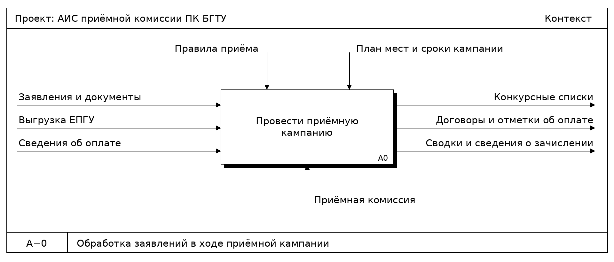
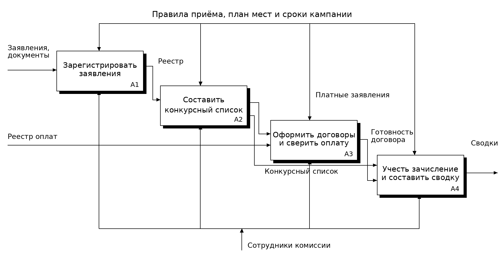
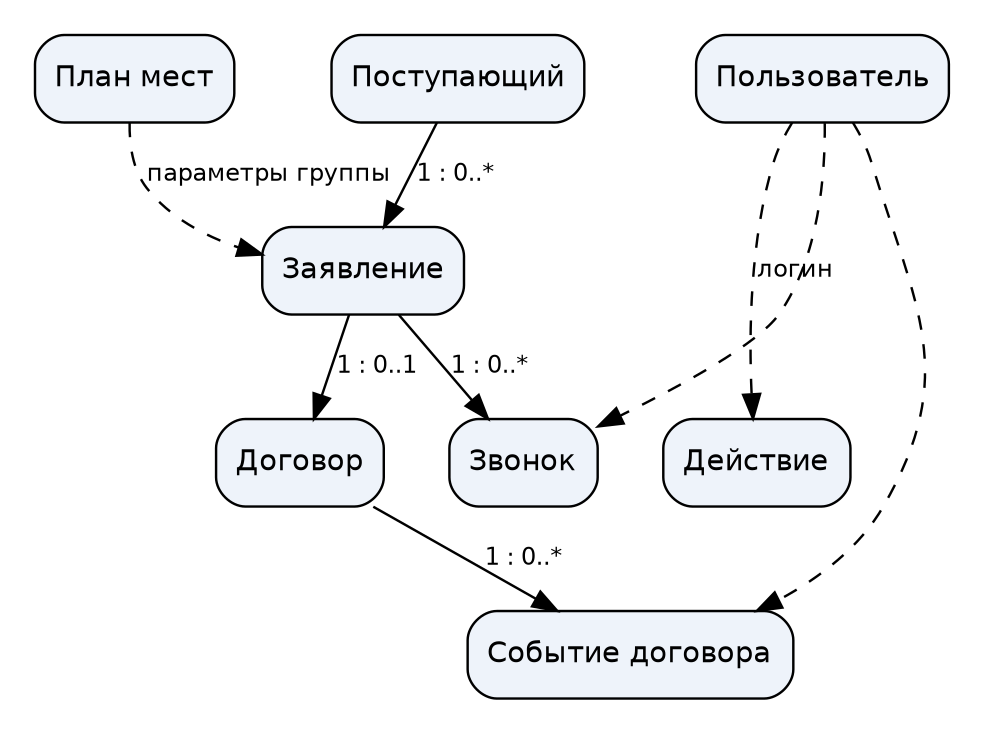
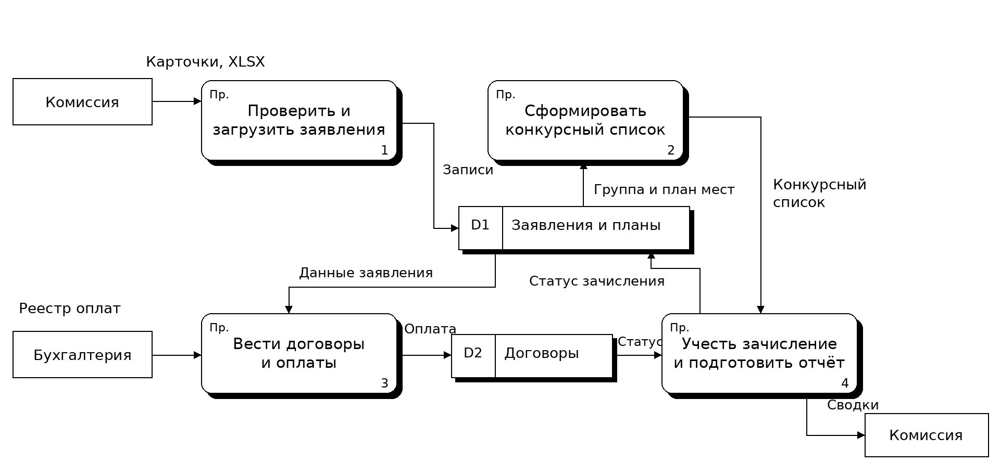
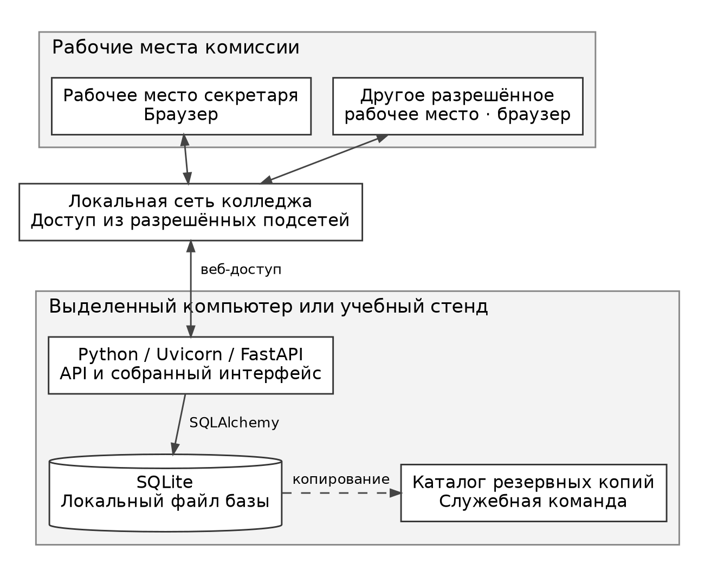
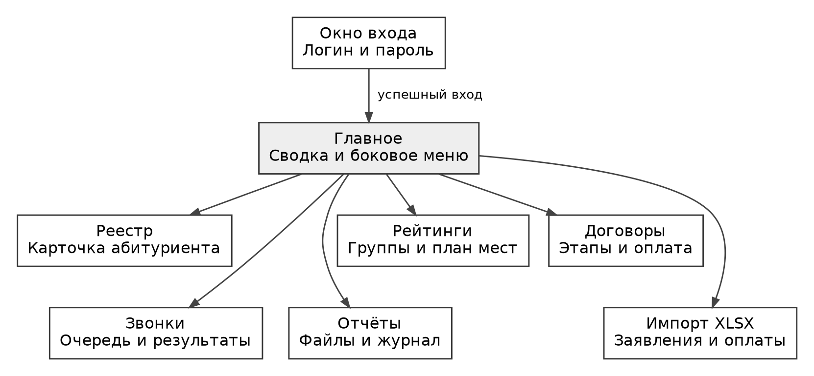
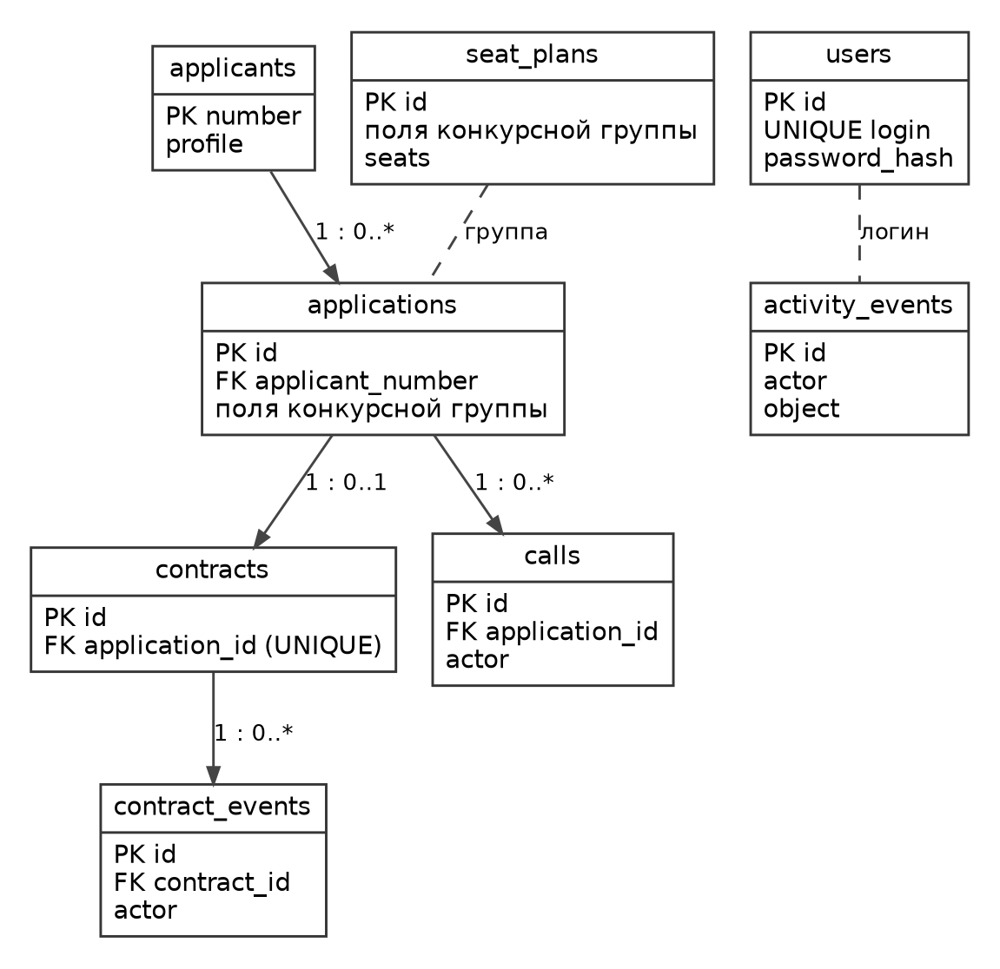

# СОДЕРЖАНИЕ

1. Анализ области использования разрабатываемого программного продукта
2. Моделирование проектируемой системы
3. Разработка технического задания
4. Разработка архитектуры программной системы
5. Разработка структуры данных

# 1. Анализ области использования разрабатываемого программного продукта

## 1.1 Описание предметной области

Разрабатываемый программный продукт представляет собой автоматизированную информационную систему приёмной комиссии Политехнического колледжа ФГБОУ ВО «Брянский государственный технический университет» (БГТУ), предназначенную для сотрудников комиссии и руководства колледжа.

Основная деятельность пользователей системы:

- приём и проверка заявлений и документов абитуриентов;

- ведение реестра поступающих и подготовка конкурсных списков;

- оформление договоров на платное обучение и учёт оплаты;

- информирование поступающих и подготовка отчётности по приёму.

Предметная область включает процессы сопровождения приёма на программы среднего профессионального образования: от регистрации заявления до учёта зачисления. Конкурс проводится по критериям действующих правил приёма колледжа с учётом документов об образовании и вступительных испытаний при их наличии.

Основные бизнес-процессы, подлежащие автоматизации:

- загрузка заявлений из Excel-файлов с проверкой данных;

- хранение сведений об абитуриентах, документах и специальностях;

- формирование конкурсных списков по установленным критериям;

- подготовка договоров по шаблону и контроль этапов оформления;

- регистрация оплаты и результатов обзвона поступающих;

- подготовка отчётов и выгрузок для передачи в систему 1С;

- ведение истории изменений и резервное копирование данных.

Проблемы текущей организации работы:

- ручной перенос сведений между таблицами требует значительных затрат времени;

- раздельное хранение заявлений, договоров и оплат приводит к расхождениям;

- ручная подготовка конкурсных списков увеличивает риск ошибок;

- бумажное согласование договоров затрудняет контроль этапов оформления;

- отсутствие единого источника информации усложняет отчётность.

Обоснование необходимости автоматизации.

Разработка АИС позволит объединить заявления, конкурсные списки, договоры и сведения об оплате в общей базе данных. Внутренний интерфейс обеспечит сотрудникам поиск и обработку информации. Сотрудники информируют поступающих через установленные колледжем каналы. Автоматизация загрузки данных и подготовки документов сократит повторный ввод и повысит согласованность учёта. История изменений и резервное копирование улучшат контроль операций и сохранность информации. Доступ к персональным данным должен разграничиваться по обязанностям пользователей.

## 1.2 Бизнес-требования

### 1.2.1 Описание бизнес-проблемы

При проведении приёмной кампании необходимо согласовывать сведения о заявлениях, конкурсных списках, договорах и оплатах. В рассматриваемом процессе учёт ведётся в отдельных электронных таблицах и на бумажных носителях, что требует ручного переноса и постоянной сверки данных.

Это приводит к следующим проблемам:

- значительные трудозатраты на ввод и проверку сведений;

- дублирование записей и расхождения между реестрами;

- задержки при обновлении конкурсных списков и подготовке отчётов;

- сложность контроля договоров и информирования поступающих.

В результате возрастает нагрузка на сотрудников и затрудняется оперативный контроль хода приёмной кампании.

Разработка АИС с общей базой данных позволит централизовать учёт и автоматизировать повторяющиеся операции. Числовые показатели далее являются целями разработки; их достижение предстоит проверить при опытной эксплуатации.

### 1.2.2 Цели бизнеса

Таблица 1.2.1 — Цели бизнеса

| Цель | Описание | Критерии успеха |
| --- | --- | --- |
| Сокращение времени обработки данных | Автоматизация загрузки и обновления сведений | Цель — сократить время обработки на 70% при сравнении одинаковых наборов данных |
| Снижение ошибок учёта | Проверка данных и контроль повторных записей | Цель — снизить число ошибок на 90% по протоколу сверки |
| Ускорение отчётности | Формирование конкурсных списков и сводных отчётов | Цель — сократить время подготовки одинакового отчёта на 80% |
| Централизация учёта | Хранение заявлений, договоров и оплат в общей базе | Связанные сведения доступны сотруднику в одном интерфейсе |

### 1.2.3 Заинтересованные стороны (Stakeholders)

Таблица 1.2.2 — Заинтересованные стороны (Stakeholders)

| Заинтересованная сторона | Роль | Интересы | Влияние |
| --- | --- | --- | --- |
| Руководство БГТУ и колледжа | Заказчик | Выполнение плана набора и контроль хода приёма | Высокое |
| Сотрудники приёмной комиссии | Основные пользователи | Быстрая обработка заявлений и снижение ручной работы | Высокое |
| Бухгалтерия и участники согласования | Участники процесса | Корректность договоров, учёт оплаты и контроль оформления | Среднее |
| Абитуриенты и их родители | Внешние участники | Актуальная конкурсная информация и понятный порядок поступления | Среднее |

### 1.2.4 Бизнес-ценность продукта

Количественная ценность:

- целевое сокращение времени обработки данных на 70% за счёт автоматизации загрузки и уменьшения повторного ввода;

- целевое снижение числа ошибок учёта на 90% благодаря проверкам и согласованному хранению сведений;

- планируемое сокращение времени подготовки отчётов на 80% относительно ручного выполнения сопоставимых операций.

Качественная ценность:

- повышение оперативности контроля приёмной кампании;

- обеспечение согласованности заявлений, договоров и сведений об оплате;

- снижение рутинной нагрузки на сотрудников приёмной комиссии;

- повышение прослеживаемости изменений и сохранности данных.

# 2. Моделирование проектируемой системы

## 2.1. Модель «как есть». Контекстная диаграмма IDEF0

Модель A−0 описывает обработку заявлений в ходе приёмной кампании ПК БГТУ. Комиссия получает заявления с документами и выгрузку ЕПГУ, бухгалтерия передаёт сведения об оплате. Результат работы — конкурсные списки, договоры, сведения о зачислении и служебные сводки.

Рисунок 2.1 — Контекстная диаграмма A−0 в нотации IDEF0

Стрелки слева обозначают входные сведения, справа — результаты. Сверху в блок входят управляющие условия: правила приёма СПО, план мест и сроки кампании. Снизу показан механизм выполнения работы — приёмная комиссия. В исходном процессе сотрудники проверяют документы, переносят данные между реестрами и сверяют результаты по первичным документам.

## 2.2. Модель «как есть». Декомпозиция A0

Верхнеуровневая функция раскрывается четырьмя блоками. Выход предыдущей работы передаётся следующей вместе с данными, нужными для её выполнения.

Рисунок 2.2 — Функциональная диаграмма A0 первого уровня в нотации IDEF0

**A1. Зарегистрировать заявления.** Сотрудник проверяет документы и заносит сведения в рабочий реестр.

**A2. Составить конкурсный список.** Комиссия распределяет заявления по группам и формирует список по правилам приёма и плану мест. Заявления на платные места передаются на оформление договоров.

**A3. Оформить договоры и сверить оплату.** Сотрудник связывает документы с заявлениями и проверяет поступление оплаты по номеру договора.

**A4. Учесть зачисление и составить сводку.** Комиссия сверяет конкурсные списки и готовность договоров, фиксирует приказ о зачислении и готовит служебную отчётность.

## 2.3. Связи данных внутри системы

Рисунок 2.3 — Информационно-логическая модель хранилищ и служебных записей

В D1 карточка поступающего связывается с одним или несколькими заявлениями. Повторы контролируются по номеру поступающего и параметрам конкурсной группы. План мест сопоставляется с заявлением по году, кампании, специальности, форме и категории. Для каждого заявления допускается до одного договора из D2. У договора может быть несколько событий, а у заявления — несколько записей обзвона. История и журнал хранят текстовый логин сотрудника. Сплошными линиями показаны связи по ключам, пунктирными — сопоставления по значениям.

## 2.4. Модель «как должно быть». Диаграмма потоков данных DFD

Диаграмма первого уровня показывает, как внутренняя АИС преобразует входные файлы и записи в служебные результаты. В модели восемь элементов: четыре процесса, два хранилища и два внешних участника. Подписанные внешние стрелки показывают обмен данными с комиссией и бухгалтерией.

Рисунок 2.4 — Диаграмма потоков данных первого уровня

**Внешние участники.** Комиссия вводит карточки или передаёт файл XLSX и получает сводки. Бухгалтерия предоставляет реестр оплат для сверки.

**Процессы 1 и 2.** Система проверяет и загружает заявления, сохраняя их в D1. При формировании конкурсного списка процесс читает заявления нужной группы и соответствующий план мест.

**Процессы 3 и 4.** Система сопоставляет заявления с договорами и сохраняет отметки об оплате в D2. Для учёта зачисления используются конкурсный список, состояние договора и реквизиты приказа, которые вносит сотрудник. После операции статус заявления записывается в D1, а сводка передаётся комиссии.

**Хранилища D1 и D2.** D1 объединяет сведения о заявлениях и планах мест. D2 хранит договоры и сведения об оплате. Заявление связано с договором внутренним идентификатором, а строки реестра оплат сопоставляются по номеру договора.

# 3. Разработка технического задания

## 3.1. Введение

Наименование программного изделия — «Автоматизированная информационная система приёмной комиссии ПК БГТУ». Область применения — внутренний учёт приёма на программы СПО. Объект автоматизации — работа сотрудников комиссии с реестром, конкурсными группами, договорами и отчётностью.

## 3.2. Основания для разработки

Основание — задание на практику по теме автоматизации приёмной комиссии Политехнического колледжа БГТУ. Номер, дата утверждения задания и должность утвердившего лица подлежат заполнению по подписанному экземпляру. Условное обозначение разработки — АИС ПК БГТУ.

## 3.3. Назначение разработки

Функциональное назначение — ведение связанных сведений о поступающих, заявлениях и договорах, подготовка конкурсных списков, учёт оплаты и зачисления. Эксплуатационное назначение — работа с данными приёмной кампании на рабочих местах комиссии через браузер во внутренней сети колледжа.

## 3.4. Требования к программе

### 3.4.1. Требования к функциональным характеристикам

Таблица 3.1 — Функциональные требования

| Требование | Состав операции и результат |
|---|---|
| Ф1. Вход сотрудника | Проверить логин и пароль активного пользователя, ограничить служебный доступ заданными подсетями, выдать токен сеанса. |
| Ф2. Реестр | Регистрировать и редактировать карточку и заявление, искать по номеру и Ф. И. О., применять фильтры кампании. |
| Ф3. Импорт | Принимать XLSX и параметры кампании. Возвращать число добавленных, изменённых и неизменённых заявлений и ошибки с номерами строк. |
| Ф4. Конкурс | Вести план мест, формировать внутренний список по параметрам группы и учебному правилу СПО: средний балл документа об образовании от 2,00 до 5,00. Равные баллы дают одинаковое место. |
| Ф5. Договоры | Вести номер, стадию, местонахождение и оплату, формировать договор и допсоглашение в одном DOCX по встроенному учебному шаблону, отражать изменения в истории. |
| Ф6. Сверка и звонки | Сопоставлять строки оплаты по номеру договора, отмечать результат звонка и сохранять комментарий. |
| Ф7. Зачисление | Регистрировать номер и дату приказа, проверять свободные места, согласие или оплату, исключать повторное зачисление в кампании. |
| Ф8. Выгрузка и эксплуатация | Формировать статистику, служебные XLSX и PDF, выгрузку JSON или XML для 1С, журнал действий и резервную копию SQLite. |

Входные данные: реквизиты учётной записи, карточка поступающего, заявление, книга ЕПГУ, план мест, шаблон договора, сведения об оплате и реквизиты приказа. Ввод выполняется в служебных формах или загрузкой файлов. Идентификаторы с ведущими нулями передаются текстом.

Выходные данные: карточка и состояние заявления, внутренний конкурсный список, протокол импорта, карточка договора, история изменений, отчёты и резервная копия. Служебные отчёты содержат выбранный период, параметры группы и состав показателей.

### 3.4.2. Требования к надёжности

Надёжность обеспечивается валидацией обязательных полей, ограничениями уникальности, транзакциями и резервным копированием. Ошибка записи должна отменять незавершённую транзакцию. При построчном импорте допустимые строки должны сохраняться, а отклонённые — попадать в протокол. Требуется проверить восстановление копии на отдельном экземпляре до ввода в эксплуатацию.

Перед началом работы администратор создаёт учётные записи. Доступ предоставляется активным пользователям из разрешённых подсетей. Резервную копию следует создавать ежедневно при изменении базы. Частота и допустимое время восстановления подлежат утверждению перед эксплуатацией.

### 3.4.3. Условия эксплуатации

Проектные условия эксплуатации — защищённый компьютер с серверным процессом, браузеры рабочих мест комиссии и обслуживающий администратор. Рабочие места используют актуальный браузер, оператор должен уметь работать с XLSX.

### 3.4.4. Требования к составу и параметрам технических средств

В комплект входят сервер или выделенная рабочая станция, клиентские компьютеры и локальная сеть. Для учебного стенда достаточно Python 3.11+, Node.js 20.19+ или 22.12+ совместимой ветви и постоянного каталога для базы. Размер хранилища уточняется по объёму рабочих файлов и сроку хранения копий. Климатические условия определяются паспортами применяемого оборудования.

### 3.4.5. Требования к информационной и программной совместимости

Совместимость обеспечивается применением Python, FastAPI, SQLite, SQLAlchemy, React и TypeScript. Для входных книг используется XLSX, для шаблона договора — DOCX. Форматы выгрузки и состав полей для загрузки в 1С согласуются с бухгалтерией. Персональные сведения, база и резервные копии размещаются в контролируемой зоне. Для рабочего развёртывания применяются защищённый транспорт и ограничение доступа на сетевом уровне.

### 3.4.6. Требования к маркировке и упаковке

Маркировка электронного комплекта включает название и версию системы. Комплект поставляется в виде исходного кода, списка зависимостей и эксплуатационных документов.

### 3.4.7. Требования к транспортированию и хранению

Хранение и передача комплекта выполняются средствами колледжа. Сроки хранения рабочих выгрузок и копий определяются регламентом обработки персональных данных.

### 3.4.8. Специальные требования

Система используется в рабочем контуре комиссии. Доступ к документам и выгрузкам получают уполномоченные сотрудники. На опытном стенде измеряются время сохранения записи, формирования отчёта и импорта XLSX. Контрольный объём данных, конфигурацию стенда и предельные времена утверждают перед приёмкой.

## 3.5. Требования к программной документации

Комплект включает техническое задание, описание архитектуры и структур данных, схемы алгоритмов, протокол испытаний, руководство системного программиста и руководство пользователя. Команды установки и требования к переменным среды должны позволять воспроизвести запуск на чистом стенде.

## 3.6. Технико-экономические показатели

Эффект оценивается сравнением времени загрузки, числа исправлений и времени подготовки отчёта на одинаковом наборе заявлений в ручном и автоматизированном процессах. Целевые ориентиры — сокращение времени обработки на 70 %, ошибок на 90 % и времени отчётности на 80 %. Для расчёта экономии трудозатрат применяется разность среднего времени двух способов, умноженная на количество операций за кампанию. Планируемая потребность — один внутренний экземпляр системы на кампанию, фактические показатели определяются опытом эксплуатации.

## 3.7. Стадии и этапы разработки

Анализ процесса и согласование ТЗ предшествуют построению модели и подготовке прототипа. На этапе реализации разрабатываются реестр, импорт, внутренние списки, работа с договорами и отчётами. Затем выполняются испытания на синтетических данных, готовится документация и оформляется протокол. Сроки и исполнители определяются заданием на практику.

Таблица 3.2 — Стадии и этапы разработки

| Этап | Результат | Ответственный по функции |
|---|---|---|
| Анализ и согласование | Модель процесса и согласованное ТЗ | Практикант и руководитель практики |
| Проектирование | Схема данных и проект рабочих форм | Практикант |
| Реализация | Версия программы и инструкции запуска | Практикант |
| Испытания | Протокол, перечень замечаний и документы | Практикант и руководитель практики |

## 3.8. Порядок контроля и приёмки

Приёмка проводится на учебном стенде по требованиям Ф1–Ф8. Для каждого сценария фиксируются вход, ожидаемый результат и наблюдение. Для допуска к реальной кампании дополнительно проверяются утверждённые правила конкурса СПО, восстановление базы, сетевой периметр и работа на объёме данных колледжа. Результаты оформляются протоколом с замечаниями и решением ответственных лиц. Программу предъявляют к приёмке вместе с руководствами и комплектом синтетических данных. При повторном испытании проверяют исправленные операции и связанные с ними сценарии.

Таблица 3.3 — Сценарии проверки технического задания

| Требование | Действие | Ожидаемый результат |
|---|---|---|
| Ф1 | Выполнить вход с верным и неверным паролем | Рабочий кабинет открывается только после успешного входа |
| Ф2–Ф3 | Загрузить тестовую книгу XLSX, повторить импорт и открыть карточку | Идентификатор сохраняет ведущие нули. Повтор не создаёт дубликат. Ошибки содержат номер строки |
| Ф4 | Указать план мест и открыть конкурс СПО с двумя равными баллами | Список упорядочен по среднему баллу. При равенстве место одинаковое |
| Ф5–Ф6 | Скачать договор Word, загрузить подтверждение оплаты и записать результат звонка | Word содержит договор и допсоглашение. Оплата и результат звонка доступны сотруднику |
| Ф7 | Внести номер приказа и дату зачисления. Повторить операцию | При выполнении условий фиксируется зачисление. Повторная операция отклоняется |
| Ф8 | Сформировать отчёт, выгрузку для 1С и копию базы | Файлы открываются в соответствующих программах. Копия пригодна для проверки на отдельном стенде |

## 3.9. Учебный стенд

Внутренний кабинет оформлен в стиле основной АИС БГТУ. Сотрудник использует боковое меню, сводку на странице «Главное» и карточку абитуриента со вкладками. В учебной базе используются вымышленные заявления, план мест и примеры договоров. Средний балл аттестата можно внести вручную или загрузить из XLSX.

При внедрении правила отбора, обработку равных баллов, льгот и вступительных испытаний требуется согласовать с колледжем. Утверждённые тарифы, реквизиты заказчика и подписи в учебный шаблон вносятся при оформлении. Целевые показатели эффективности оцениваются по результатам отдельного испытания.

# 4. Разработка архитектуры программной системы

## 4.1. Выбор архитектуры

Для АИС приёмной комиссии колледжа выбрана трёхуровневая клиент-серверная архитектура. Интерфейс, серверная обработка и хранение данных выполняют разные задачи. Сотрудник работает через браузер. Сервер проверяет права доступа и применяет правила кампании. SQLite хранится на компьютере, где запущен сервер приложений. Для учебного стенда достаточно одного компьютера.

1. **Уровень представления.** React и TypeScript отображают страницу входа, сводку, реестр и рабочие формы. Данные передаются через HTTP в формате JSON. Для загрузки и скачивания используются файловые запросы.
2. **Уровень прикладной логики.** FastAPI принимает запросы, проверяет входные данные и вызывает операции импорта, конкурса, договоров, обзвона, зачисления и отчётности.
3. **Уровень данных.** SQLAlchemy связывает операции с таблицами SQLite. Сеанс записи выполняется в транзакции. Ограничения уникальности предотвращают повторное создание заявления, плана или договора с теми же ключами.

## 4.2. Диаграмма компонентов и описание модулей

На рисунке 4.1 показано, как браузерный интерфейс обращается к прикладным компонентам и как они работают с общей базой.

{width=15.7cm}

Рисунок 4.1 — Диаграмма компонентов

Таблица 4.1 — Компоненты программной системы

| Модуль | Назначение | Реализация | Взаимодействие |
|---|---|---|---|
| Вход и контроль доступа | Проверяет учётные данные, активность пользователя, JWT и сетевой допуск | `security.py`, служебные зависимости `api.py`, форма `Login` | Все служебные маршруты |
| Реестр и импорт | Ведёт карточки и заявления, проверяет строки XLSX и формирует протокол | `Registry`, `ImportModal`, `import_epgu` | SQLite, конкурс, договоры |
| Конкурс СПО | Проверяет средний балл, связывает заявления с планом мест и расставляет места | `Rankings`, `college.py`, `ranking` | Реестр, план мест, отчётность |
| Договоры и оплата | Ведёт этапы договора, выводит Word, сверяет оплаты по номеру договора | `Contracts`, `create_contract`, `render_contract`, `reconcile_payments` | Заявления, бухгалтерская книга XLSX, история изменений |
| Звонки и зачисление | Формирует очередь звонков и сохраняет их результаты. Регистрирует зачисление по реквизитам приказа | `Calls`, `call_queue`, маршрут зачисления в `api.py` | Реестр, договоры, план мест |
| Отчёты и эксплуатация | Формирует сводки и файлы, ведёт журнал, позволяет создать резервную копию | `Reports`, `web.py`, `export_1c`, `backup_database` | База, служебные выгрузки, 1С |

Технологический стек включает Python 3.11+, FastAPI, Uvicorn, SQLAlchemy, SQLite, React, TypeScript и Vite. Openpyxl обрабатывает XLSX, python-docx формирует Word, ReportLab создаёт PDF.

## 4.3. Диаграмма развёртывания

На рисунке 4.2 показано размещение компонентов. Сервер приложений обслуживает собранный интерфейс и запросы API. SQLite и резервные копии располагаются на стороне сервера.

{width=14.0cm}

Рисунок 4.2 — Диаграмма развёртывания

На учебном стенде сервер слушает локальный адрес 127.0.0.1. При работе со служебного компьютера в сети колледжа сетевые параметры, защищённый транспорт и каталог резервного хранения задаются администратором. Резервная копия создаётся служебной командой. Порядок регулярного копирования и сроки хранения утверждаются перед вводом в эксплуатацию.

## 4.4. Схема переходов между формами

После проверки логина и пароля сотрудник попадает на страницу «Главное». Сводка и меню дают доступ к рабочим разделам на рисунке 4.3.

{width=15.7cm}

Рисунок 4.3 — Схема переходов между формами

Форма «Реестр» открывает карточку абитуриента и его заявления. В «Рейтингах» сотрудник выбирает конкурсную группу и категорию. Раздел «Договоры» показывает этап, оплату и историю договора, а также позволяет скачать Word. В «Звонках» доступны очередь и запись результата. В «Отчётах» выбираются отчёт и формат файла. Импорт заявлений запускается со страницы «Главное», импорт оплат доступен из раздела договоров.

# 5. Разработка структуры данных

## 5.1. Схема базы данных

Рисунок 5.1 показывает физические связи в SQLite и сопоставления по общим значениям. Сплошные линии обозначают внешние ключи, пунктирные — логические сопоставления. План мест связан с заявлением через год, кампанию, направление, форму обучения и квоту. В служебных событиях логин сотрудника хранится как текст.

{width=15.0cm}

Рисунок 5.1 — Структура данных АИС приёмной комиссии

## 5.2. Описание таблиц

В таблицах 5.1–5.8 приведены имена полей, типы, размеры и назначение. В столбце «Размер» указан объявленный предел для строк с ограничением длины. «Авто» означает назначение целочисленного первичного ключа базой, «—» означает отсутствие фиксированного размера в модели. PK обозначает первичный ключ, FK — внешний ключ.

Таблица 5.1 — Абитуриенты (`applicants`)

| Имя поля | Тип | Размер | Описание |
|---|---|---|---|
| `number` | VARCHAR | 64 | PK. Идентификатор абитуриента из ЕПГУ. Сохраняет ведущие нули |
| `surname` | VARCHAR | — | Фамилия |
| `first_name` | VARCHAR | — | Имя |
| `patronymic` | VARCHAR | — | Отчество |
| `profile` | JSON | — | Контакты, документы об образовании и другие сведения карточки |
| `updated_at` | DATETIME | — | Дата и время последнего обновления |

Таблица 5.2 — Заявления (`applications`)

| Имя поля | Тип | Размер | Описание |
|---|---|---|---|
| `id` | INTEGER | Авто | PK. Внутренний идентификатор заявления |
| `applicant_number` | VARCHAR | 64 | FK → applicants.number |
| `year` | INTEGER | — | Год приёмной кампании |
| `campaign` | VARCHAR | — | Кампания или уровень образования |
| `direction` | VARCHAR | — | Направление или специальность |
| `study_form` | VARCHAR | — | Форма обучения |
| `quota` | VARCHAR | — | Категория конкурса |
| `priority` | INTEGER | — | Номер приоритета |
| `status` | VARCHAR | — | Текущее состояние заявления |
| `total_score` | INTEGER | — | Конкурсный балл. Для СПО хранится в сотых долях |
| `achievements` | INTEGER | — | Баллы индивидуальных достижений из исходных данных |
| `exams` | JSON | — | Результаты вступительных испытаний по предметам |
| `consent` | BOOLEAN | — | Признак полученного согласия |
| `enrolled_at` | DATETIME | — | Дата и время зачисления, если оно оформлено |
| `source` | JSON | — | Исходные поля импорта, средний балл СПО или реквизиты приказа |

Таблица 5.3 — План мест (`seat_plans`)

| Имя поля | Тип | Размер | Описание |
|---|---|---|---|
| `id` | INTEGER | Авто | PK. Внутренний идентификатор плана |
| `year` | INTEGER | — | Год кампании |
| `campaign` | VARCHAR | — | Кампания или уровень образования |
| `direction` | VARCHAR | — | Направление или специальность |
| `study_form` | VARCHAR | — | Форма обучения |
| `quota` | VARCHAR | — | Категория конкурса |
| `seats` | INTEGER | — | Число мест для конкурсной группы |

Таблица 5.4 — Договоры (`contracts`)

| Имя поля | Тип | Размер | Описание |
|---|---|---|---|
| `id` | INTEGER | Авто | PK. Внутренний идентификатор договора |
| `number` | VARCHAR | — | Уникальный номер договора |
| `application_id` | INTEGER | — | FK → applications.id. Уникальное поле, одному заявлению соответствует до одного договора |
| `location` | VARCHAR | — | Место нахождения документа |
| `stage` | VARCHAR | — | Этап оформления договора |
| `paid` | BOOLEAN | — | Признак подтверждённой оплаты |
| `created_at` | DATETIME | — | Время создания |

Таблица 5.5 — История договоров (`contract_events`)

| Имя поля | Тип | Размер | Описание |
|---|---|---|---|
| `id` | INTEGER | Авто | PK. Идентификатор события договора |
| `contract_id` | INTEGER | — | FK → contracts.id |
| `at` | DATETIME | — | Дата и время события |
| `actor` | VARCHAR | — | Логин сотрудника |
| `changes` | JSON | — | Изменения реквизитов или статусов договора |

Таблица 5.6 — Звонки (`calls`)

| Имя поля | Тип | Размер | Описание |
|---|---|---|---|
| `id` | INTEGER | Авто | PK. Идентификатор звонка |
| `application_id` | INTEGER | — | FK → applications.id |
| `result` | VARCHAR | — | Код результата разговора |
| `comment` | VARCHAR | — | Комментарий сотрудника |
| `actor` | VARCHAR | — | Логин сотрудника |
| `at` | DATETIME | — | Дата и время записи |

Таблица 5.7 — Пользователи (`users`)

| Имя поля | Тип | Размер | Описание |
|---|---|---|---|
| `id` | INTEGER | Авто | PK. Идентификатор учётной записи |
| `login` | VARCHAR | — | Уникальный логин |
| `password_hash` | VARCHAR | — | Хеш пароля bcrypt |
| `active` | BOOLEAN | — | Признак активной учётной записи |

Таблица 5.8 — Журнал действий (`activity_events`)

| Имя поля | Тип | Размер | Описание |
|---|---|---|---|
| `id` | INTEGER | Авто | PK. Идентификатор записи журнала |
| `at` | DATETIME | — | Дата и время события |
| `actor` | VARCHAR | — | Логин сотрудника |
| `action` | VARCHAR | — | Наименование операции |
| `object` | VARCHAR | — | Объект операции |
| `detail` | VARCHAR | — | Дополнительное описание |
| `status` | VARCHAR | — | Результат операции |

## 5.3. Ограничения целостности

Уникальность заявления проверяется по номеру абитуриента, году, кампании, направлению, форме обучения и категории. Для плана мест используется тот же набор без номера абитуриента. Номер договора и ссылка договора на заявление также уникальны. Время зачисления допускает отсутствие значения до оформления приказа. JSON-поля позволяют сохранять набор реквизитов документа и исходные поля книги без изменения схемы при добавлении вспомогательных столбцов.
